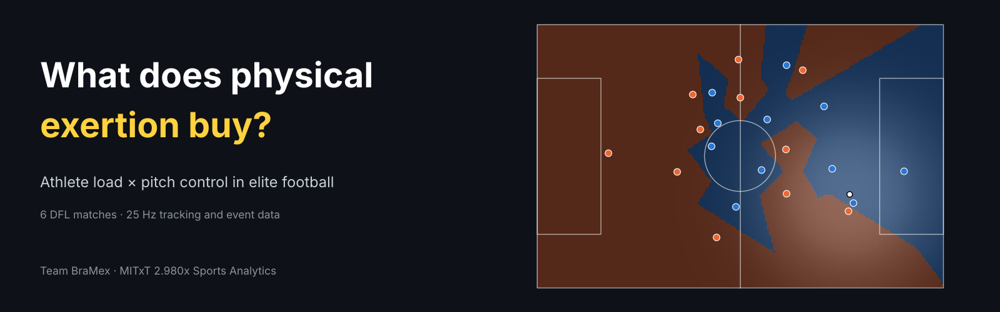

<p align="center">
  
</p>

<p align="center">
  
  
  
  
  
  
</p>

# BraMex: what does physical exertion buy in a football match?

Team project for **MITxT 2.980x Sports Analytics**. We study what physical exertion, positioning and team behaviour are associated with in professional football, using 25 Hz tracking and event data from six matches, and turn that into predictions evaluated on an unseen game.

<p align="center">
  <a href="https://colab.research.google.com/github/leonardoeng13/bramex-football-exertion-pitch-control/blob/main/notebooks/BraMex_team_notebook.ipynb"></a>
</p>

| | |
|---|---|
| Team notebook | [notebooks/BraMex_team_notebook.ipynb](notebooks/BraMex_team_notebook.ipynb) |
| Project plan, schedule and decision log | [BraMex Team plan (GitHub Project)](https://github.com/users/leonardoeng13/projects/9) |
| Shared pipeline | [src/bramex](src/bramex) |

> **Status:** work in progress. Shared pipeline (Parts 1 to 4) and Workstream A are in the notebook; Workstreams B and C, integration and prediction are in progress.

## Questions

| Workstream | Owner | Focus |
|---|---|---|
| A. Players and physical load | Leonardo De Andrade | Is individual exertion linked to pitch control? Do load metrics agree? Is fatigue visible? |
| B. Team possession, progression and defense | Monica D. Morales-Hernandez | Possession vs pitch control, ball progression, where teams win the ball back |
| C. Chances and possession changes | Pablo Saraiva | What precedes shots and turnovers, and can they be predicted seconds ahead? |

## Repository structure

| Path | Content |
|---|---|
| `src/bramex/` | Shared pipeline used by every workstream: configuration, data loading, standard tables, data checks, feature registry |
| `notebooks/BraMex_team_notebook.ipynb` | Team notebook: setup, shared tables, three workstreams, integration, prediction, holdout inference |
| `pyproject.toml` | Package definition and dependencies |

## Getting started

The DFL files are not in this repository (see Data availability). Each member uses their own copy of the course data.

**Local (Anaconda or venv, Python 3.10+)**
```bash
git clone https://github.com/leonardoeng13/bramex-football-exertion-pitch-control.git
cd bramex-football-exertion-pitch-control
conda create -n bramex python=3.12 -y && conda activate bramex   # or python -m venv .venv
pip install -e .
python -m ipykernel install --user --name bramex --display-name "Python (bramex)"
```
Set the data folder, then open `notebooks/BraMex_team_notebook.ipynb` with the `Python (bramex)` kernel:
```bash
export BRAMEX_DATA_DIR="/path/to/folder/with/DFL/xml"        # macOS / Linux
setx BRAMEX_DATA_DIR "E:\path\to\folder\with\DFL\xml"         # Windows (open a new terminal afterwards)
```

**Google Colab**
1. Copy the DFL XML files to `MyDrive/BraMex/data` in Google Drive.
2. Open the notebook in Colab: *File → Open notebook → GitHub*, paste the repository URL.
3. Run Part 1. It installs the package from GitHub and mounts Google Drive.

**Other hosted notebooks (Kaggle, Deepnote, SageMaker)**
Upload the XML files, run `pip install git+https://github.com/leonardoeng13/bramex-football-exertion-pitch-control.git`, and set `DATA` in cell 1.2 to the folder with the files.

**Cache.** Part 3 builds the shared tables once per match, then reads them from the cache (`BRAMEX_CACHE_DIR`, default `<data>/cache`). The cache folder name includes a hash of the decision-log parameters, so changing a parameter rebuilds the tables instead of mixing versions. Sharing the cache folder between members avoids rebuilding it.

**Working rules.** Shared code changes in `src/bramex` go through the PM. Workstream code stays in its own part of the notebook. Clear all outputs before committing.

## Data availability

Raw tracking and event data are **not included** in this repository. They were provided to participants of MITxT 2.980x Sports Analytics (MIT) and originate from DFL Deutsche Fußball Liga, published by Bassek, Rein, Weber and Memmert (2025), *An integrated dataset of spatiotemporal and event data in elite soccer*, Scientific Data 12, 195. Course materials remain the property of MIT. To reproduce the analysis, obtain the data from its original source and set `BRAMEX_DATA_DIR` (see `.env.example`).

## Local setup

Create an isolated environment, install the declared dependencies and copy `.env.example` to `.env`. Set `BRAMEX_DATA_DIR` to the folder containing the DFL XML files. The local `.env`, raw XML files and generated caches are ignored by Git.

```powershell
py -3.13 -m venv .venv
.\.venv\Scripts\python.exe -m pip install -r requirements.txt
Copy-Item .env.example .env
```

Run the structural audit before analysis. It validates all six three-file match bundles, frame rate, pitch dimensions, event alignment and active-play possession switches. It also creates a compact local cache for Workstream C.

```powershell
.\.venv\Scripts\python.exe scripts\audit_dfl_data.py
.\.venv\Scripts\python.exe scripts\build_workstream_c_baseline.py
.\.venv\Scripts\python.exe scripts\fit_workstream_c_initial_model.py
```

Run the synthetic target-construction tests with:

```powershell
$env:PYTHONPATH = "src"
.\.venv\Scripts\python.exe -m unittest discover -s tests -v
```

## Team BraMex

| | Role |
|---|---|
| **Leonardo De Andrade** | PM & integration lead |
| **Monica D. Morales-Hernandez** | Modeling lead (ML & DS) |
| **Pablo Saraiva** | Evaluation & validation lead |
